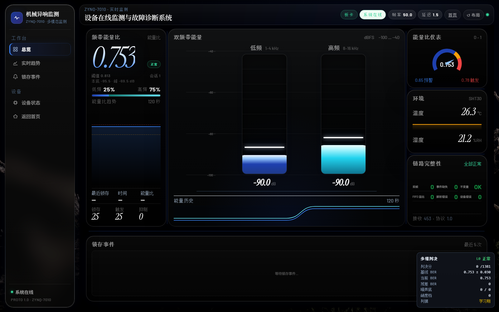
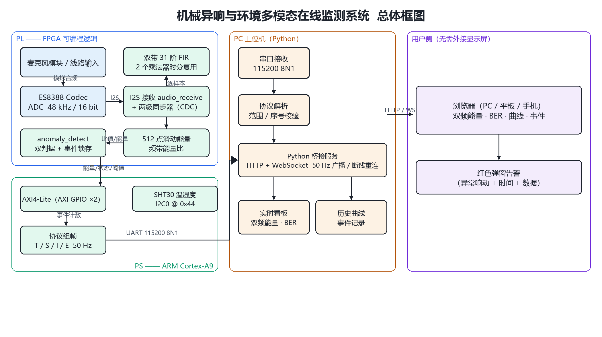
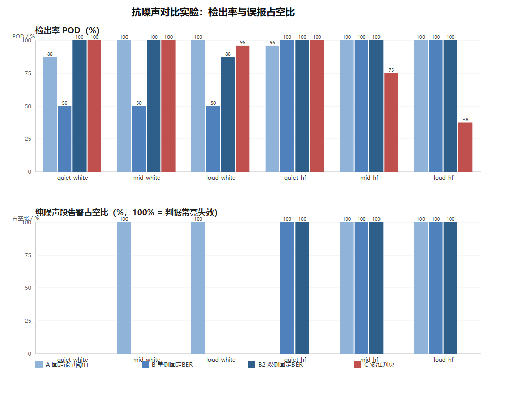

# 工业机械异响与环境监测系统

[](https://github.com/guosiqi616-glitch/zynq-acoustic-monitor/actions/workflows/tests.yml)

基于 **Zynq-7010** 的机械异响在线监测系统：FPGA 做双频带声学特征提取，ARM 做动态基线统计判决，浏览器做实时可视化。

> 面向工业车间与机房运维：在异响变成故障之前，把它变成可读的信号。

---

## 演示视频

[](docs/演示视频.mp4)

▶ **[点击观看完整演示（1 分 29 秒）](docs/演示视频.mp4)**

系统架构 → 实时监测界面 → 语音不报警 → 13 kHz 啸叫告警。

> 编码 H.264 / 1280×816 / 30 fps / 14.9 MB


---

## 这套系统解决什么

车间里最先出问题的设备，往往不是最响的那台。轴承刚起磨损时，声音的变化只有几分贝，混在风机和电机的底噪里，人耳分辨不出来。等真能听见，通常已经该停机了。

固定阈值监测在这个场景里会失效——安静机房里调好的阈值，一到嘈杂车间就一直报警。本项目的做法是**不跟固定数字比，跟自己比**：开机先学习当前环境的底噪与波动，之后只看偏离基线多少个标准差。

---

## 亮点

| 特性 | 说明 |
|---|---|
| 双频带声学感知 | 1–4 kHz / 8–16 kHz 两路 31 阶线性相位 FIR，输出频带能量与能量比 |
| 硬件流式处理 | 滤波、能量、比值全部在 PL 完成；单样本 32 拍 @50 MHz，占预算 3.1% |
| 动态基线判决 | 2.5σ 门控 EWMA + 二维卡方（谱形 + 峭度），环境变了基线跟着变 |
| 语音抑制 | 利用"语音能量集中在 4 kHz 以下"这一物理事实，持续 440 ms 即判为干扰 |
| 免外接显示屏 | 数据走 UART，浏览器渲染；判决中间量可解释 |
| 抗噪声验证 | 144 次对照实验：固定阈值占空比 100%（失效），本方案 0% |

---

## 系统架构



```
声音 → ES8388 → I2S → PL（双带 FIR / 能量 / 比值） → AXI GPIO → PS（动态基线 / 卡方判决）
                                                                    ↓
                                                          UART 文本帧 50 Hz
                                                                    ↓
                                                    Python 桥接（解析/统计）
                                                                    ↓
                                                    WebSocket → 浏览器
```

**软硬分工**：ARM 一帧原始音频都不碰，只消费特征；PL 的处理时间是确定的，不受调度抖动影响。

---

## 界面


右下角的"多维判决"浮层显示判决中间量：基线 μ±σ、当前偏离、判决分、噪声底。报警因此可解释。

---

## 目录结构

```
.
├── project_1.srcs/              Verilog 源码与约束
│   └── sources_1/new/audio/
│       ├── audio_receive.v      I2S 串并转换 + 两级同步器
│       ├── audio_energy.v       双带 FIR + 滑动能量 + 能量比  ★核心
│       ├── anomaly_detect.v     双判据判决 + 事件锁存          ★核心
│       ├── kurtosis_monitor.v   峭度统计（已实现，未接入判决）
│       └── i2c_dri.v            配置 ES8388 的 I2C 主机
├── vitis_workspace/anomaly_detect_app/src/
│   ├── helloworld.c             PS 主程序：50 Hz 主循环、协议组帧
│   └── detector.h               动态基线、卡方判决、语音抑制   ★核心
├── host_software/
│   ├── relay/                   HTTP + WebSocket 桥接服务
│   ├── web/                     首页与实时监测看板
│   ├── tools/                   实验脚本与测试工具
│   ├── lib/                     协议解析
│   └── sim/                     模拟设备（无硬件也能调界面）
├── docs/                        设计与测试文档
├── source/                      说明书与写作依据（含数据溯源）
├── test_audio/DEMO_20261103/    演示音频素材
└── records/                     实验结果 CSV / 图表
```

---

## 快速开始

### 硬件

- 正点原子 领航者 ZYNQ-7010 开发板（XC7Z010）
- ES8388 音频编解码（板载）
- SHT30 温湿度传感器（I2C0，地址 0x44）
- 音频输入：麦克风模块 或 3.5 mm 线路输入

### 烧写与运行

```powershell
# 1. 板子上电，连接 USB-UART

# 2. 烧写 PL + PS（约 20 秒）
D:\Xilinx\Vitis\2020.2\bin\xsct.bat run_board.tcl

# 3. 启动上位机
cd host_software
..\.venv\Scripts\python.exe relay\server.py --source serial:COM5@115200 --port 8080 --mode board

# 4. 打开浏览器
#    http://127.0.0.1:8080/dashboard.html
```

或者双击根目录的 `启动演示.bat`，会自动找串口、烧写、起服务、开浏览器。

### 没有硬件？

```powershell
python relay\server.py --source sim --port 8080
```

用内置模拟设备驱动界面，方便调 UI。

---

## 串口协议（v1.1）

文本帧，逗号分隔，115200 8N1：

| 帧 | 频率 | 内容 |
|---|---|---|
| `I` | 1 Hz | 设备信息、协议版本、采样率 |
| `T` | 50 Hz | 序号、时间、温湿度、两路 dB、能量比、状态、事件计数 |
| `S` | 1 Hz | 状态标志、错误计数 |
| `E` | 事件触发 | 事件：dB、能量比、阈值、原因 |
| `X` | 10 Hz | 诊断：级别、判决分、基线 μ/σ、噪声底、峭度、标志位 |

完整字段定义、哨兵值与 flags 位见 [`docs/协议说明.md`](docs/协议说明.md)；解析器见 `host_software/lib/protocol.py`。

---

## 实验结果

144 次对照实验（2 类背景噪声 × 3 档强度 × 4 类异响 × 6 次重复）：

| 判据 | 噪声条件下的告警占空比 |
|---|---|
| 固定能量阈值 | 0 / 100 / 100 / 0 / 100 / 100 % |
| 固定能量比阈值（单侧） | 0 / 0 / 0 / 100 / 100 / 100 % |
| 固定能量比阈值（双侧） | 0 / 0 / 0 / 100 / 100 / 100 % |
| **本方案（动态基线）** | **0 / 0 / 0 / 0 / 0 / 0 %** |

同时 4 类异响在多数条件下检出率 ≥ 95%。



详细数据见 `records/exp_results.csv` 与 `docs/测试报告_抗噪声对比.md`。

---

## 实测指标

| 项目 | 数值 |
|---|---|
| 采样率 | 47.95 kHz |
| 遥测帧率 | 50 Hz，丢帧 0 |
| 单样本处理 | 32 拍 @50 MHz = 0.64 µs（预算 3.1%） |
| 资源占用 | LUT 10.5% / FF 8.0% / DSP 7.5% / BRAM 0 |
| 时序 | WNS > 0 |
| FIR 群延迟 | 0.31 ms |
| 事件上报延迟 | ≤ 20 ms（50 Hz 轮询） |

---

## 已知限制

诚实列出，也是下一步的方向：

- **异常上报是轮询**：50 Hz 读取锁存，延迟 ≤ 20 ms；AXI 中断未接
- **峭度未接入判决**：`kurtosis_monitor.v` 已实现但顶层未例化，`status[31:28]` 恒为 0
- **单次冲击不可分**：关门、脚步与机械冲击在时域同构，目前都算异常
- **无音频回溯**：串口带宽（115 kbps）不足以回传原始音频
- **麦克风通路信噪比不足**：实测敲击/说话峰值约 1000，环境噪声可达 900，判据难以稳定区分；演示推荐线路输入

---

## 文档

| 文件 | 内容 |
|---|---|
| `docs/作品说明书.docx` | 作品说明书（条目式：功能特性、技术特点、指标表、创新点、实验数据） |
| `docs/协议说明.md` | 串口协议完整字段定义、哨兵值、flags 位 |
| `docs/系统组成与使用说明.md` | 软硬件组成与运行说明 |
| `docs/接线与麦克风.md` | 麦克风模块接线与增益调整 |
| `docs/音频通路验证.md` | 音频链路自检步骤 |
| `docs/测试报告_抗噪声对比.md` | 144 次实验的完整数据 |
| `docs/创新点证据卡.md` | 各创新点对应的证据与话术 |
| `docs/演示流程.md` | 演示脚本与素材顺序 |
| `source/写作依据.docx` | 每个数字的出处、每条文献支撑哪一段 |

---

## 许可证

见 `LICENSE`。如用于课程或竞赛，请注明出处。
